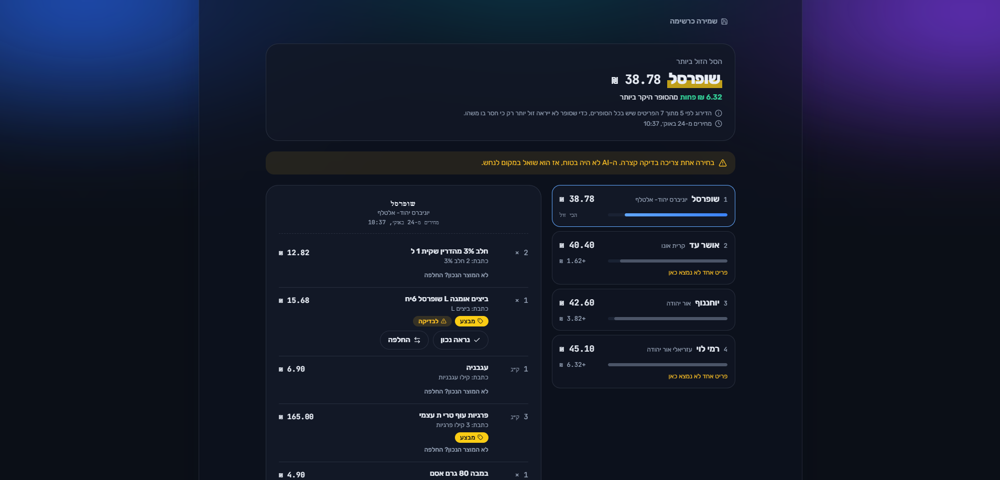
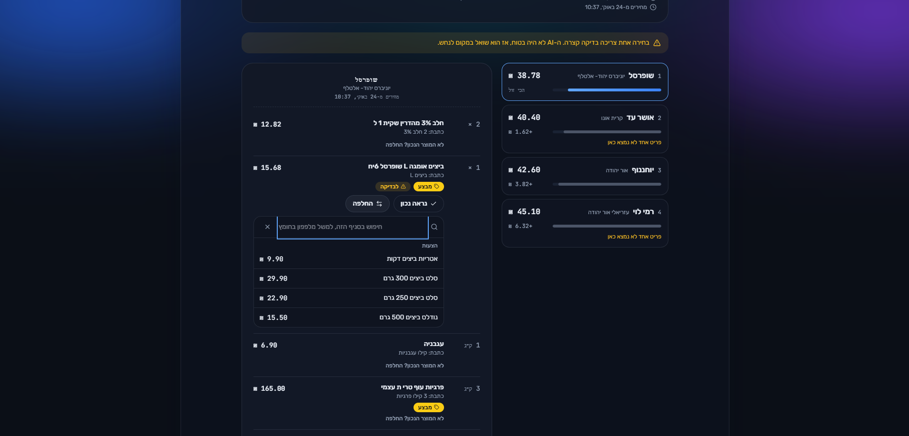
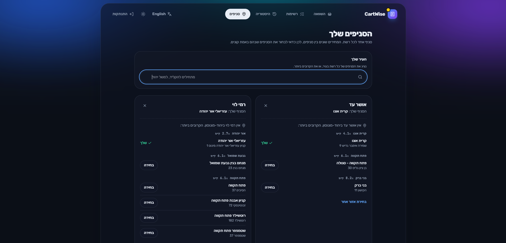

# CartWise

**[Live demo](https://cartwise-vmn4.onrender.com)** (Render free tier: the first request can take up to a minute while the server wakes up)

Type your weekly grocery list in plain Hebrew and CartWise finds the cheapest basket across Shufersal, Rami Levy, Yohananof and Osher Ad. Prices come from the files every chain must publish by law (the 2014 Food Act, חוק קידום התחרות בענף המזון), refreshed daily.



<details>
<summary>More screenshots</summary>

### Typing a list


### Checking an unsure pick


### Choosing branches by city


</details>

## How it works

1. **Ingest.** Every morning, download the official price, promotion and branch files for the branches users follow, and load them into PostgreSQL.
2. **Understand the list.** The AI turns free text ("2 חלב 3%", "קילו עגבניות", "3 קילו פרגיות") into items, quantities and units.
3. **Match.** Trigram search finds the closest real products at each branch, and the AI picks among those candidates only. Confident picks are remembered; unsure ones are marked "check this" until the user confirms or swaps them.
4. **Compare.** Each chain's total uses regular prices plus deals open to every shopper (club-only deals are excluded, weighted items are priced per kilo). Chains are ranked on the items all of them carry, so a chain doesn't look cheaper just because it's missing something.

**The AI suggests, the database decides, and when the AI isn't sure, the user confirms.** Prices always come from the published files, never from the model, and any product code the model invents is thrown away.

When the AI is slow or unavailable, CartWise keeps working: each call has a 20-second budget, a quota error moves to a fallback model, a circuit breaker stops calling a failing AI for 5 minutes, and a rule-based reader takes over (every pick is then marked for checking).

## Features

- Free-text lists in Hebrew or English, with quantities, kilos and half-kilos
- Per-chain baskets with deals, savings, and "a product is missing here" warnings
- Swap any product or search the branch's shelf; your choices are remembered
- Branch picker by city, with the nearest branch of each chain and distances
- Accounts with saved lists and comparison history; guests compare on four demo branches in Ashdod
- English and Hebrew interface (full right-to-left layout), light and dark themes, mobile layout

## Tech stack

| Layer | Choice |
|-------|--------|
| Backend | FastAPI, SQLAlchemy 2.0, Alembic, Pydantic v2 |
| Database | PostgreSQL 16 with `pg_trgm` |
| AI | Gemini 2.5 Flash (free tier) behind a provider interface |
| Frontend | React 19, TypeScript (strict), Vite, Tailwind CSS 4, React Router 7 |
| Tests | pytest against a real PostgreSQL with a fake AI; Vitest for frontend logic |
| Hosting | Render (Docker API in Frankfurt, static site), Neon PostgreSQL |
| Automation | GitHub Actions: CI on every push, daily price refresh with catch-up runs |

The backend is layered: routers handle HTTP only, services hold the business rules and raise domain errors with a stable `code`, and the frontend translates that code into English or Hebrew.

## Running locally

Requires Docker and a free [Gemini API key](https://aistudio.google.com/apikey).

```bash
git clone https://github.com/OsherElikamel/cartwise.git
cd cartwise
cp backend/.env.example backend/.env    # then set GEMINI_API_KEY
docker compose up --build
```

The app runs at http://localhost:5173 and the API docs at http://localhost:8000/docs. The database starts empty, so load the cities, the branch lists and the demo branches once:

```bash
docker compose exec backend python -m app.ingestion.run stores       # every chain's branch list
docker compose exec backend python -m app.ingestion.run localities   # cities, and which branch is where
docker compose exec backend sh -c 'for b in "rami-levy 709" "shufersal 92" "yohananof 5" "osher-ad 9"; do python -m app.ingestion.run track $b --demo; done'
docker compose exec backend python -m app.ingestion.run prices       # today's prices for tracked branches
```

### Tests

```bash
docker compose up -d db
docker compose exec db createdb -U cartwise_user cartwise_test   # once
cd backend && python -m venv .venv && .venv/bin/pip install -r requirements.txt
.venv/bin/pytest            # 101 tests, against a cartwise_test database on port 5433

cd ../frontend && npm ci && npm test
```

## Ingestion

```bash
python -m app.ingestion.run nightly                  # branch lists, pruning, prices, cache cleanup
python -m app.ingestion.run prices --stale-hours 12  # only branches a run missed
python -m app.ingestion.run track shufersal 205      # start following a branch
```

Each branch is replaced inside one transaction, so a half-loaded branch is never visible, and a PostgreSQL advisory lock keeps two loads of the same branch from running at once. Shufersal's site sometimes stalls when called from GitHub's US servers, so its requests retry with a backoff, and two catch-up runs later in the day reload whatever the morning run missed.

| Chain | Source |
|-------|--------|
| Shufersal | prices.shufersal.co.il |
| Rami Levy | url.publishedprices.co.il |
| Yohananof | url.publishedprices.co.il |
| Osher Ad | url.publishedprices.co.il |

## Limits and what's next

- The Gemini free tier allows about 20 AI requests a day per model, enough for a demo but not for real traffic.
- Distances are city to city; exact branch locations and "use my location" are next.
- Planned: product links, price history, and a split basket that buys each item where it's cheapest.

## Data sources

- Prices, promotions and branches: the files each chain publishes under the 2014 Food Act.
- Localities: the official list on [data.gov.il](https://data.gov.il/dataset/citiesandsettelments).
- City coordinates: © [OpenStreetMap](https://www.openstreetmap.org/copyright) contributors, ODbL, via Nominatim (built once by `backend/scripts/build_localities.py`).

## License

MIT
